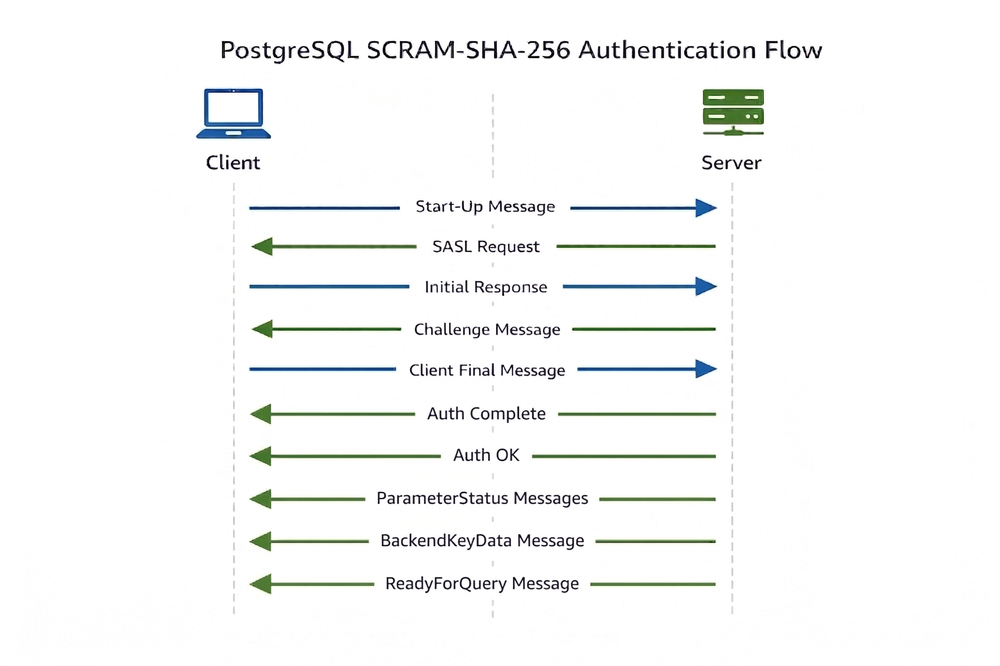

## Authentication Steps:

1. The client writes a start-up message
2. The server responds with supported authentication mechanisms
3. The client chooses one of the mechanisms
4. The client & server, then, exchange more messages, depending on the chosen authentication mechanism, to complete the authentication

**SASL Authentication using SCRAM-SHA-256 is explained below:**



> [!NOTE]
> Since PostgreSQL communication is entirely based on structured byte messages, understanding their exact format is essential. This document focuses on message structure and byte-level representation to provide a clear and precise understanding of the protocol.


### Index

1. [Start-up Message](#1-start-up-message)
2. [SASL Request Message](#2-sasl-request-message)
3. [SASL Initial Response Message](#3-sasl-initial-response-message)
4. [SASL Continue Message](#4-sasl-continue-message)
5. [SASL Final Response Message](#5-sasl-final-response-message)
6. [SASL Complete Message](#6-sasl-auth-complete-message)
7. [Authentication OK Message](#7-authentication-ok-message)
8. [Post Authentication Messages](#8-post-authentication-messages)
   - 8.1 [Parameter Status Messages](#81-parameterstatus-messages)
   - 8.2 [Backend Key Message](#82-backendkeydata-message)
   - 8.3 [ReadyForQuery Message](#83-readyforquery-message)
9. [Algorithm to generate client proof & expected server signature](#9-algorithm-to-generate-client-proof--expected-server-signature)

### 1. Start-Up Message

- Sent by the client to initiate the authentication
- Contains information like username, database name & other config options
- Start-up Docs [here](https://www.postgresql.org/docs/18/protocol-flow.html#PROTOCOL-FLOW-START-UP)

#### Format:

- Format Docs [here](https://www.postgresql.org/docs/18/protocol-message-formats.html#PROTOCOL-MESSAGE-FORMATS-STARTUPMESSAGE)
- Int32: Length of message contents in bytes, including self.
- Int32: The protocol version number (3.2)
- Key-value pairs, containing information like username, database & other options. Both Keys & values are terminated by a zero byte (0)
- Zero Byte (0) to mark the end of the parameters

#### Example:

```go
startupBytes := []byte{
    // length of the message including self: 33
    0, 0, 0, 33,

    // so, the next 29 bytes contain actual message:

    // postgres protocol version: 3.2
    // the most 16 significant bits represent the major version (3)
    // the least 16 significant bits represent the minor version (2)
    0, 3, 0, 2,

    // bytes representation of `user` key, terminated by a zero byte
    117, 115, 101, 114, 0,

    // bytes representation of `user` value `postgres`, terminated by a zero byte
    112, 111, 115, 116, 103, 114, 101, 115, 0,

    // bytes represenation of `database` key, terminate by a zero byte
    100, 97, 116, 97, 98, 97, 115, 101, 0,

    // bytes representation of `database` value `postgres`, terminated by a zero byte
    112, 111, 115, 116, 103, 114, 101, 115, 0,

    // can have more key-value pairs for config options

    // final zero byte to represent the end of the parameters
    0,
}
```

### 2. SASL Request Message:

- Sent by the server to tell the client that SASL authentication is supported, and also contains the list of the supported SASL authentication mechanisms (`SCRAM-SHA-256`, `SCRAM-SHA-256-PLUS`, `OAUTHBEARER`)
- We will follow the `SCRAM-SHA-256` mechanism
- SASL Authentication docs [here](https://www.postgresql.org/docs/18/sasl-authentication.html)

#### Format:

- Format Docs [here](https://www.postgresql.org/docs/18/protocol-message-formats.html#PROTOCOL-MESSAGE-FORMATS-AUTHENTICATIONSASL)
- Byte1: Single byte with value 'R', indicating an authentication request message.
- Int32: Length of the message in bytes, including self
- Int32: Value is 11, indicating the message is a SASL challenge
- Byten: List of authentication mechanisms supported, each terminated by a zero byte
- Final zero byte

#### Example

```go
saslReqMessage := []byte{
    // byte representation of 'R', indicating authentication request
    82,

    // length of the message, including self
    0, 0, 0, 23,

    // so, the next 19 bytes contain the actual message

    // bytes represenation of value 10, indicating a SASL request message
    0, 0, 0, 10,

    // bytes representation of `SCRAM-SHA-256`, terminated by a zero
    83, 67, 82, 65, 77, 45, 83, 72, 65, 45, 50, 53, 54, 0,

    // final zero byte
    0,
}
```

### 3. SASL Initial Response Message

- The client sends the initial SASL response to tell the chosen auth mechanism (`SCRAM-SHA-256` in our case), and additional data based on the chosen auth mechanism.
- In `SCRAM-SHA-256`, the additional includes:
  - channel binding info (GS2 header),
  - the username of the database (although its value is ignored by PostreSQL),
  - and a randomly generated nonce.
- The string representation of the additional data is: `<channel_binding_flag>,<authorization_id>,n=<database_username>,r=<client_nonce>`
- Hence, an example would be `n,,n=postgres,r=MCLZAZHITS5UUQHUIQSZTT4RS5`
- In our case, we don't use channel binding. So the flag value is a single byte 'n', and authorization id is also empty.

#### Format

- Format Docs [here](https://www.postgresql.org/docs/18/protocol-message-formats.html#PROTOCOL-MESSAGE-FORMATS-SASLINITIALRESPONSE)
- Byte1: Single byte with value 'p', indicating initial SASL response
- Int32: Length of the message in bytes, including self
- String: Name of the chosen auth mechanism (`SCRAM-SHA-256` in our case), terminated by a zero byte
- Int32: Length of the _additional data_ based on the chosen auth mechanism
- Byten: Additonal data containing database username & randomly generated nonce

#### Example

```go
saslInitialResponse := []byte{
    // byte representation of 'p', indicating initial SASL response
    112,

    // length of the message, including self
    0, 0, 0, 64,

    // so, the next 60 bytes contain the actual message

    // bytes representation of `SCRAM-SHA-256`, terminated by a zero
    83, 67, 82, 65, 77, 45, 83, 72, 65, 45, 50, 53, 54, 0,

    // length of the additional data
    0, 0, 0, 42,

    // so the next 42 bytes contain additional data

    // bytes representation of `n,,` (channel binding info)
    110, 44, 44,

    // bytes representation of `n=postgres,` (database username)
    110, 61, 112, 111, 115, 116, 103, 114, 101, 115, 44,

    // bytes representation of `r=MCLZAZHITS5UUQHUIQSZTT4RS5` (randomly generated nonce)
    114, 61, 77, 67, 76, 90, 65, 90, 72, 73, 84, 83, 53, 85, 85, 81, 72, 85, 73, 81, 83, 90, 84, 84, 52, 82, 83, 53,
}
```

### 4. SASL Continue Message

- Sent by the server to continue the SASL authentication
- This message contains info required by the client to generate the proof (that it knows the correct database password)
- In our case (SCRAM-SHA-256), the server responds with additional data containing info like server nonce, a salt & number of iterations.
- The combined nonce: client_nonce appended with server_nonce
- The salt is Base64 encoded
- The iterations count is a numeric value (e.g. 4096)
- The format of the additional data is: `r=<combined_nonce>,s=<salt>,i=<iterations>`.
- Hence, an example would be `r=MCLZAZHITS5UUQHUIQSZTT4RS5vzsaoPnbmkYp9H9Fj/h3fR/J,s=CKwZ2EjTo/+2N2jA682mxQ==,i=4096`

#### Format

- Format Docs [here](https://www.postgresql.org/docs/18/protocol-message-formats.html#PROTOCOL-MESSAGE-FORMATS-AUTHENTICATIONSASLCONTINUE)
- Byte1: Single byte with value 'R', indicating an authentication request message.
- Int32: Length of the message in bytes, including self
- Int32: Value is 11, indicating the message is a SASL challenge
- Byten: Additional data containing server nonce, salt & the number of iterations

#### Example

```go
saslContinueBytes := []byte{
    // byte representation of 'R', indicating authentication request
    82,

    // length of the message, including self
    0, 0, 0, 94,

    // so, the next 90 bytes contain the actual message

    // bytes represenation of value 11, indicating a SASL challenge message
    0, 0, 0, 11,

    // bytes representation of `r=MCLZAZHITS5UUQHUIQSZTT4RS5vzsaoPnbmkYp9H9Fj/h3fR/J,` (combined nonce)
    114, 61, 77, 67, 76, 90, 65, 90, 72, 73, 84, 83, 53, 85, 85, 81, 72, 85, 73, 81, 83, 90, 84, 84, 52, 82, 83, 53, 118, 122, 115, 97, 111, 80, 110, 98, 109, 107, 89, 112, 57, 72, 57, 70, 106, 47, 104, 51, 102, 82, 47, 74, 44,

    // bytes representation of `s=CKwZ2EjTo/+2N2jA682mxQ==,` (salt)
    115, 61, 67, 75, 119, 90, 50, 69, 106, 84, 111, 47, 43, 50, 78, 50, 106, 65, 54, 56, 50, 109, 120, 81, 61, 61, 44,

    // bytes representation of `i=4096` (iterations count)
    105, 61, 52, 48, 57, 54,
}
```

### 5. SASL Final Response Message

- The client sends the final SASL response to prove it has the database password.
- The data part contains three parts:
  - c: base64 encoded GS2 header (channel binding data) info. We sent `n,,` in SASL initial response, so it becomes `biws` in base64
  - r: the combined nonce, received in the SASL continue response
  - p: the generated proof
- The format of the data string is: `c=<base64_encoded_gs2_header>,r=<combined_nonce>,p=<client_proof>`
- Hence, an example would be `c=biws,r=MCLZAZHITS5UUQHUIQSZTT4RS5vzsaoPnbmkYp9H9Fj/h3fR/J,p=VBhLqrXutfrS0plKlSvCaLQy03g8OK2DBQ7stE70JSw=`
- In this step, we also generate the server sign (expected) to be sent by the server after it verifies the client's authenticity.
- The algorithm to generate the client proof & the expected server sign is explained at the end [here](#9-algorithm-to-generate-client-proof--expected-server-signature).

#### Format

- Format Docs [here](https://www.postgresql.org/docs/18/protocol-message-formats.html#PROTOCOL-MESSAGE-FORMATS-SASLRESPONSE)
- Byte1: Single byte with value 'p', indicating initial SASL response
- Int32: Length of the message in bytes, including self
- Byten: Additonal data containing server nonce & client proof

#### Example

```go
saslFinalResponse := []byte{
    // byte representation of 'p', indicating initial SASL response
    112,

    // length of the message, including self
    0, 0, 0, 110,

    // so, the next 106 bytes contain the actual message

    // bytes representation of `c=biws,` (base64 encoded GS2 header)
    99, 61, 98, 105, 119, 115, 44,

    // bytes representation of `r=MCLZAZHITS5UUQHUIQSZTT4RS5vzsaoPnbmkYp9H9Fj/h3fR/J,` (combined nonce)
    114, 61, 77, 67, 76, 90, 65, 90, 72, 73, 84, 83, 53, 85, 85, 81, 72, 85, 73, 81, 83, 90, 84, 84, 52, 82, 83, 53, 118, 122, 115, 97, 111, 80, 110, 98, 109, 107, 89, 112, 57, 72, 57, 70, 106, 47, 104, 51, 102, 82, 47, 74, 44,

    // bytes representation of `p=VBhLqrXutfrS0plKlSvCaLQy03g8OK2DBQ7stE70JSw=` (client proof)
    112, 61, 86, 66, 104, 76, 113, 114, 88, 117, 116, 102, 114, 83, 48, 112, 108, 75, 108, 83, 118, 67, 97, 76, 81, 121, 48, 51, 103, 56, 79, 75, 50, 68, 66, 81, 55, 115, 116, 69, 55, 48, 74, 83, 119, 61,
}
```

### 6. SASL Auth Complete Message

- The server sends the SASL final message to verify the client's authenticity.
- The server also sends a verification signature, which the client can use to validate the server's authenticity by matching it against the generated server key in the previous step, establishing a two-way verification system.
- The format of the data string is: `v=<server_signature>`
- Hence, an example would be `v=Il0cQnK6mSx1ivNZYULOJEwbUiS8CJLFIVZ1WP5mjc0=`

#### Format

- Format Docs [here](https://www.postgresql.org/docs/18/protocol-message-formats.html#PROTOCOL-MESSAGE-FORMATS-AUTHENTICATIONSASLFINAL)
- Byte1: Single byte with value 'R', indicating an authentication request message.
- Int32: Length of the message in bytes, including self
- Int32: Value is 12, indicating SASL authentication is completed
- Byten: Additional data containing server signature

#### Example

```go
saslCompleteMessage := []byte{
    // byte representation of 'R', indicating authentication request
    82,

    // length of the message, including self
    0, 0, 0, 54,

    // so the next 50 bytes contain the actual message

    // bytes representation of value 12, indicating SASL auth is complete
    0, 0, 0, 12,

    // bytes representation of `v=Il0cQnK6mSx1ivNZYULOJEwbUiS8CJLFIVZ1WP5mjc0=` (server signature)
    118, 61, 73, 108, 48, 99, 81, 110, 75, 54, 109, 83, 120, 49, 105, 118, 78, 90, 89, 85, 76, 79, 74, 69, 119, 98, 85, 105, 83, 56, 67, 74, 76, 70, 73, 86, 90, 49, 87, 80, 53, 109, 106, 99, 48, 61,
}
```

### 7. Authentication OK Message

- The server sends the authentication OK message to indicate the completion of authentication process.
- The client is not required to respond to this message.

#### Format

- Format Docs [here](https://www.postgresql.org/docs/18/protocol-message-formats.html#PROTOCOL-MESSAGE-FORMATS-AUTHENTICATIONOK)
- Byte1: Single byte with value 'R', indicating an authentication request message.
- Int32: Length of the message in bytes, including self. Its value is 8.
- Int32: Value is 0, indicating authentication is OK

#### Example

```go
authOKMessage := []byte{
    // byte representation of 'R', indicating authentication request
    82,

    // length of the message, including self
    0, 0, 0, 8,

    // so the next 4 bytes contain the actual message

    // bytes representation of value 0, indicating authentication is OK
    0, 0, 0, 0,
}
```

### 8. Post Authentication Messages

- After the authentication is completed, the backend server sends a series of message:
  - a bunch of `ParameterStatus` messages,
  - a `BackendKeyData` message, and
  - finally a `ReadyForQuery` message
- The client is not required to respond to these messages. It just reads the bytes to clear the stream and save the needed information, e.g. the backend key or some server parameters.

#### 8.1 ParameterStatus messages

- The server sends a bunch of parameter messages informing the client of some server config details like Timezone, client encoding, server encoding, search path, server version and so on.
- Each message contains a single config item. Both key and value are terminated by a zero byte.

##### Format:

- Format Docs [here](https://www.postgresql.org/docs/18/protocol-message-formats.html#PROTOCOL-MESSAGE-FORMATS-PARAMETERSTATUS)
- Byte1: Single byte with value 'S', indicating parameter status message
- Int32: Length of the message in bytes, including self
- Byten: Parameter in format `<key>0<value>0`

##### Example

```go
timezoneParameterBytes := []byte{
    // byte representation of 'S', indicating a ParameterStatus message
    83,

    // length of the message including self
    0, 0, 0, 26,

    // so, the next 22 bytes contain the actual message

    // bytes representation of `TimeZone`, terminated by a zero byte (config key)
    84, 105, 109, 101, 90, 111, 110, 101, 0,

    // bytes representation of `Asia/Kolkata`, terminated by a zero byte (config value)
    65, 115, 105, 97, 47, 75, 111, 108, 107, 97, 116, 97, 0,
}
```

#### 8.2 BackendKeyData message

- The server sends a key to the client to support query cancellation.
- The key is 32 bytes, although its maximum size is 256 bytes (reserved for future versions), and it was 4 bytes in earlier versions.

##### Format

- Format Docs [here](https://www.postgresql.org/docs/18/protocol-message-formats.html#PROTOCOL-MESSAGE-FORMATS-BACKENDKEYDATA)
- Byte1: Single byte with value 'K', indicating backend key message
- Int32: Length of the message in bytes, including self
- Int32: ProcessId of the backend
- Byten: The backend key

##### Example

```go
backendKeyMessage := []byte{
    // byte representation of 'K', indicating a BackendKeyData message
    75,

    // length of the message including self
    0, 0, 0, 40,

    // so, the next 36 bytes contain the actual message

    // bytes representation of value 13053, the backend process id
    0, 0, 50, 253,

    // the backend key (32 bytes)
    162, 50, 253, 135, 151, 88, 24, 213, 99, 117, 29, 117, 210, 68, 42, 211, 183, 106, 141, 113, 57, 30, 46, 35, 39, 110, 35, 152, 149, 154, 230, 36,
}
```

#### 8.3 ReadyForQuery message

- The server sends this message to the client to notify that it is ready to receive SQL commands.
- This message contains the current backend transaction status, indicating if the backend is currently:
  - `I`: in the idle state,
  - `T`: in a transactional block,
  - `E`: in a failed transactional block.

##### Format

- Format Docs [here](https://www.postgresql.org/docs/18/protocol-message-formats.html#PROTOCOL-MESSAGE-FORMATS-READYFORQUERY)
- Byte1: Single byte with value 'Z', indicating ReadyForQuery message
- Int32: Length of the message in bytes, including self
- Byte1: Current backend transaction status. Possible values are I, T, E.

##### Example

```go
backendKeyMessage := []byte{
    // byte representation of 'Z', indicating a ReadyForQuery message
    90,

    // length of the message including self
    0, 0, 0, 5,

    // so, the next 1 byte contains the actual message

    // bytes representation of `I`, the backend transaction status (idle)
    73,
}
```

### 9. Algorithm to generate client proof & expected server signature

- In [SASL final response](#5-sasl-final-response-message), the client prepares & sends a proof to the server. This proof is required by server to ensure that the client has the correct database password.

>[!NOTE]
> Explanation of used cryptographic algorithms (PBKDF2 & HMAC) is outside the scope of this document.

#### 1. Prepare SASL initial bare message

- Format of `sasl_initial_bare`: `n=<username>,r=<client_nonce>`
- Username & client_nonce are generated by the client in the [SASL initial response](#3-sasl-initial-response-message)

#### 2. Prepare SASL continue bare message

- Format of `sasl_continue_bare`: `r=<combined_nonce>,s=<salt>,i=<iterations>`
- This data is sent by the server in the [SASL continue message](#4-sasl-continue-message)

#### 3. Prepare SASL final bare message without proof

- Format of `sasl_final_bare`: `c=biws,r=<combined_nonce>`
- `biws` is the base64 encoded form of GS2 header sent in the [SASL initial response](#3-sasl-initial-response-message)

#### 4. Prepare auth message:

- Format of `auth_message`: `<sasl_initial_bare>,<sasl_continue_bare>,<sasl_final_bare>`
- `sasl_initial_bare`, `sasl_continue_bare` and `sasl_final_bare` were prepared in the previous three steps.

#### 5. Decode Salt

- The salt received in the [SASL continue message](#4-sasl-continue-message) is base64 encoded. So, we need to decode it, and also strip the potential zero bytes from the right end.
- `decoded_salt`: <decoded_salt>

#### 6. Generate Salted Password

- Generate the salted password using the `PBKDF2` algorithm.

  ```go
  import (
      "crypto/pbkdf2"
      "crypto/sha256"
  )

  saltedPassword, err := pbkdf2.Key(sha256.New, password, decodedSalt, iterations, 32)
  ```

- Iterations count is already received in the [SASL continue message](#4-sasl-continue-message)

#### 7. Generate Client & Stored Key

- The client key is generated using the `HMAC` algorithm.
- The `saltedPassword`, generated in the previous step, is used as the key, and the string literal `Client Key` is used as data.
- The stored key is obainted by calculating the SHA256 checksum of the client key.

  ```go
  h := hmac.New(sha256.New, saltedPassword)
  if _, err := h.Write([]byte("Client Key")); err != nil {
      // return error
  }

  clientKey := h.Sum(nil)
  storedKey := sha256.Sum256(clientKey)
  ```

#### 8. Prepare Client Signature

- Client Signature is prepared using the `HMAC` algorithm.
- The stored key, generated in the step 7, is used as the key.
- The auth message, generated in the step 4, is used as the data.

```go
h := hmac.New(sha256.New, storedKey[:])
if _, err := h.Write(authMessage); err != nil {
	// return error
}

clientSignature := h.Sum(nil)
```

#### 9. Prepare Client Proof

- Client Proof is obtained by caculating the XOR result of `clientKey` and `clientSignature`.
- The `clientKey` was created in step 7, and the `clientSignature`, in the previous step.
- The client proof is then base64 encoded, before being sent to the server.

  ```go
  clientProof := byte_utils.XorBytes(clientKey, clientSignature)
  encodedClientProof := byte_utils.EncodeToBase64(clientProof)
  ```

#### 10. Prepare Expected Server Sign

- Using `HMAC` algorithm, with `saltedPassword` as key, and string literal `Server Key` as data, generate the server key.
- With the server key, and `authMessage` as data, obtain the server sign using the `HMAC` algorithm again.
- Apply base64 encoding to this sign, as the server will also send the base64-encoded signature.

  ```go
  h := hmac.New(sha256.New, saltedPassword)
  if _, err := h.Write([]byte("Server Key")); err != nil {
      return nil, err
  }

  serverKey := h.Sum(nil)

  h2 := hmac.New(sha256.New, serverKey)
  if _, err := h2.Write(authMessage); err != nil {
      return nil, err
  }

  serverSign := h2.Sum(nil)

  base64EncodedSign := byte_utils.EncodeToBase64(serverSign)
  return base64EncodedSign, nil
  ```
